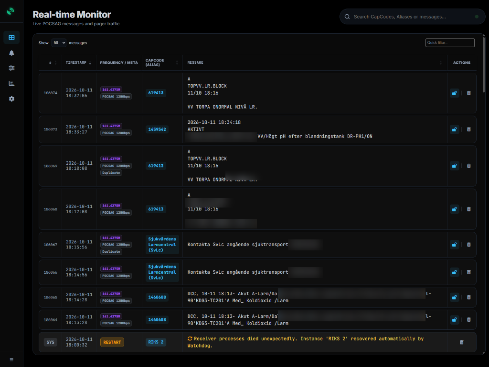

# PagerMonitor

[](CHANGELOG.md)
[](https://github.com/Minglarn/pagermonitor/commits/main)
[](https://github.com/Minglarn/pagermonitor/issues)
[](https://github.com/Minglarn/pagermonitor/stargazers)
[](https://github.com/Minglarn/pagermonitor/pkgs/container/pagermonitor)

PagerMonitor ar en komplett, containeriserad Software Defined Radio (SDR) overvakningsplattform for realtidsmottagning, avkodning och analys av tradlosa radio- och satellitprotokoll. Systemet har ett modernt morkt webbgransnitt (OLED/Glassmorphism), dynamisk multi-SDR-hantering, avancerad ordbevakning, inbaddade interaktiva sjokort/kartor (Leaflet), och fullt stod for MQTT-integration till t.ex. Home Assistant eller Node-RED.

<p align="center">
  
</p>

---

## Protokoll som Stods

### 1. HFDL - High Frequency Data Link (Kortvågs-flygdata)
* **dumphfdl Integration**: Tar emot och avkodar JSON-strömmar från `dumphfdl` (v1.7.0+, standard TCP/UDP port `15556`).
* **Omfattande Dataavkodning**: Avkodar Frekvens- & Hörbarhetsrapporter (vilka markstationer runt jorden som flygplanet hör), Prestandarapporter (paketstatistik 300-1800 bps, spdu squitter och frekvensbytesorsaker) och kapslade ACARS-meddelanden.
* **Smart Flygplans-cache**: Sammanfogar `ac_info` (`icao`, `regnr`, `model`, `typecode`, `owner`) från inloggningspaket till efterföljande ACARS- och positionsrapporter.
* **Geografisk Kartvisualisering**: Placerar flygplan på den inbäddade kvadratiska minikartan och kartmodalen vid mottagen position.

### 2. Inmarsat STD-C / EGC / SafetyNET / SAR (SATC)
* **SatDump Integration**: Tar emot och avkodar radseparerade JSON-datastrommar fran SatDump (`inmarsat_stdc_parser`, standardport `6558` over UDP/TCP eller via anpassad fjarr-IP).
* **Maritima Larm och Varningar**: Full avkodning av SafetyNET, Navigationsvarningar (NAVWARN/NAVAREA), Vaderskrivelser (METAREA), Flottmeddelanden (FleetNET), och Sjorraddningslarm (SAR / Distress Relay).
* **Automatisk Jordstations- och Satellitidentifiering**: Identifierar Inmarsat-satelliter (t.ex. IOR, AOR-E) och Land Earth Stations (LES, t.ex. Burum, Eik, Aussaguel, Goonhilly).
* **Inbaddad Leaflet-Minikarta**: Meddelanden med GPS-koordinater renderas automatiskt med en interaktiv minikarta till hoger i meddelandecellen. Kartan kombinerar OpenStreetMap med OpenSeaMap-sjokortsoverlay for full maritim kontext. Klick pa positionsbadgen zoomar direkt in till zoomniva 13.
* **Strikt Filtrering av Delpaket och Krypto**: Ignorerar ofullstandiga multi-part fragment och filtrerar automatiskt bort krypterade paket (t.ex. ryska `5PRCRYPTO`/`5PSCRYPTO`) och binar telemetri tolkad som ASCII.

### 2. VDL2 / ACARS (VHF Data Link Mode 2)
* **Flygkommunikation**: Tar emot avkodade VDL2- och ACARS-ramar fran `dumpvdl2` via UDP-stromning.
* **Rutt- och Flygplatsavkodning**: Extraherar ICAO-flygplatser (t.ex. ESSA Arlanda, ESGG Landvetter, EGLL Heathrow) och presenterar flygplatsetiketter.
* **Flygdata & Pilotmeddelanden**: Visar flygnummer (Flight), flygplanets registrering (Tail/Reg), ICAO-adress (24-bit hex), ACARS-labels, och markerar pilotmeddelanden.
* **Flerfrekvensstod**: Hanterar flera samtida VDL2-kanaler (t.ex. 136.725 MHz, 136.875 MHz, 136.975 MHz).

### 3. RadioSonde (Vadersonder & Ballonger)
* **Atmosfarisk Telemetri**: Tar emot sonddata fran `radiosonde_auto_rx` over UDP.
* **Sensordata**: Visar sondens serienummer, frekvens, GPS-position (lat/lon), flyghojd (MSL), temperatur, relativ luftfuktighet, stighastighet och beraknad burst/landning.

### 4. POCSAG (Personsokare)
* **Avkodning via multimon-ng**: Stod for POCSAG 512, 1200 och 2400 baud.
* **Entropibaserat Brusfilter**: Filtrerar automatiskt bort felaktiga ramar och radiostorningar utan att tappa korta giltiga larm.
* **Europeisk Teckenuppsattning**: Full konvertering for svenska tecken (A, A, O).

### 5. TETRA & RDS-TMC
* **TETRA RAKEL Overvakning**: Logger for TETRA-basstationer och natverkshandelser, med mojlighet att filtrera bort repetitiv basstationstelemetri.
* **RDS-TMC**: Avkodning av trafikmeddelanden fran FM-sandare.

---

## Funktioner i Webbgransnittet

* **Flodespaus vid Mus-hover**: Nar muspekaren placeras over meddelandeflodet pausas tabellen automatiskt och en svavande statusbricka ("Flodet Pausat") tands. Nya meddelanden buffras i bakgrunden och spolas in direkt nar musen lamnar flodet.
* **DataTables 2 med Sticky Headers**: Blixtsnabb sortering, paginering och fritextsokning i realtid med ladda-fler historik.
* **RF Activity Ribbon**: Visar ett 60-minuters spektrumnarvaro-vattenfall for alla aktiva kanaler och frekvenser med klickbara snabbfilter.
* **Dedikerad Larmvy (`/alarms`)**: Samlar alla meddelanden som triggat pa anvandarens aktiva larmord med fargkodade larmbadgar och prioritetspuls.
* **CapCode & Adress-Alias**: Koppla numeriska adresser eller ICAO-koder till vardagliga namn (t.ex. "Raddningstjanst", "SAS Flight SK142").
* **Live Docker Console**: Inbyggd realtidsterminal i nederkant som visar containerloggar via SSE med niva-markeringar och filtrering.
* **Databasstatistik och Autorensning**: KPI-kort over databasens storlek, meddelandevolym och automatisk schemalagd rensning av gamla data.

---

## MQTT & Hemautomation

PagerMonitor publicerar varje avkodat meddelande automatiskt till valfri MQTT-broker (t.ex. Mosquitto eller Home Assistant).

### Exempel pa JSON-payload
```json
{
  "timestamp": "2026-10-16T08:59:26.000000",
  "address": "LES: 312, Stratos Global (Burum)",
  "message": "[Inmarsat STD-C / Textmeddelande] Sat: IOR | Jordstation: Burum | Prioritet: Routine\nWEEKLY GMDSS TEST IN PORT - CARNIVAL LEGEND\nGPS POSN : 41 01.66 N 028 59.28 E",
  "alias": "Inmarsat-C",
  "bitrate": "SATC-600",
  "frequency": "1539.421M",
  "protocol": "SATC",
  "priority": "Routine",
  "lat": 41.02767,
  "lon": 28.98800,
  "alert_word": null,
  "is_duplicate": false
}
```

### Home Assistant Automation (Exempel)
```yaml
alias: "PagerMonitor: Maritimt eller flyglarm"
description: "Skickar mobilnotis vid SAR-larm eller bevakat larmord"
triggers:
  - trigger: mqtt
    topic: pagermonitor/alarms
conditions:
  - condition: template
    value_template: >-
      {{ trigger.payload_json.alert_word | length > 0 or
         trigger.payload_json.priority == 'DISTRESS' }}
actions:
  - action: notify.notify
    data:
      title: "LARM: {{ trigger.payload_json.alias }}"
      message: "{{ trigger.payload_json.message }}"
      data:
        priority: high
```

---

## Snabbstart med Docker Compose

Anvand filen `docker-compose.yml` for enkel distribution:

```yaml
services:
  pagermonitor:
    image: ghcr.io/minglarn/pagermonitor:latest
    container_name: pagermonitor
    restart: unless-stopped
    devices:
      - /dev/bus/usb:/dev/bus/usb
    volumes:
      - ./data:/app/data
    environment:
      - MQTT_BROKER=127.0.0.1
      - MQTT_PORT=1883
      - MQTT_TOPIC=pagermonitor/alarms
      - TZ=Europe/Stockholm
      - AUTH_USER=admin
      - AUTH_PASS=
    ports:
      - "7090:5000"   # Webbgranssnitt
      - "6558:6558/udp" # Inmarsat STD-C SatDump UDP
      - "6558:6558"     # Inmarsat STD-C SatDump TCP
      - "5555:5555/udp" # VDL2 dumpvdl2 UDP
      - "5556:5556/udp" # RadioSonde auto_rx UDP
```

### Starta tjansten
```bash
# Starta i bakgrunden
docker compose up -d

# Folj live-loggar
docker compose logs -f
```

Oppna webblasaren pa: **`http://<SERVER_IP>:7090`**

---

## Menyöversikt i Webbgränssnittet

* **Monitor (`/`)**: Huvudfloedet i realtid med inbaddade Leaflet-minikartor, snabbfilter och RF-aktivitet.
* **Larm (`/alarms`)**: Separat vy for meddelanden som matchat aktiva larmord.
* **Alias (`/aliases`)**: Hantera CapCodes, adresser, flygbolag och muting.
* **Larmord (`/alert_words`)**: Konfigurera bevakningsord och farger.
* **Statistik (`/statistics`)**: Protokollfordelning, timdiagram och stationsstatistik.
* **Installningar (`/settings`)**: Konfigurera SDR-enheter, VDL2/RadioSonde/SATC-portar och databasunderhall.
